# EvoOntology PoC 報告

> **這份報告要回答三件事**
> 1. EvoOntology 底層到底怎麼運作？（第 2 章）
> 2. 我做了什麼實驗、結果如何？（第 3 章）
> 3. 這個 PoC 涵蓋了 EvoOntology 的哪些步驟、哪些還沒碰？（第 4 章）
>
> 流程圖使用 Mermaid（GitHub、VS Code 的 Markdown 預覽、Obsidian、Typora 都能畫出來）；
> 每張圖下面都有文字說明，即使圖沒有渲染也看得懂。
> 報告日期：2026-10-27　主實驗（v2）日期：2026-10-22　模型：Claude Sonnet 5.5（Builder 與所有測試 agent 相同）

## 目錄

1. [一頁摘要](#1-一頁摘要)
2. [EvoOntology 底層做法](#2-evoontology-底層做法)
3. [PoC 做了什麼](#3-poc-做了什麼)
4. [PoC 涵蓋了哪些步驟、哪些沒有](#4-poc-涵蓋了哪些步驟哪些沒有)
5. [對改寫成 deterministic pipeline 的啟示](#5-對改寫成-deterministic-pipeline-的啟示)
6. [限制與誠實說明](#6-限制與誠實說明)
7. [建議的下一步](#7-建議的下一步)
8. [附錄](#8-附錄)

---

## 1. 一頁摘要

### 1.1 結論

| 你關心的問題 | 答案 | 信心 |
| --- | --- | --- |
| 建出來的 ontology 能不能讓 agent 在**沒看過的問題**上變好？ | **能。** 40 題留出題，無 ontology 62% → 有 ontology 90%。11 題轉對、0 題轉錯（p=0.001） | 中：1 次/題、資料是我設計的 |
| ontology 比「把業務說明直接貼進 prompt」好嗎？ | **沒有。** 貼文件 100%，ontology 90%（差 4 題，p=0.125，統計上分不出） | 中 |
| 為什麼 ontology 輸給貼文件？ | 4 題錯誤都能追到原因：**知識有建進去，但 agent 沒用對詞取不到**（3 題），以及**沒被問過的定義沒進 ontology**（1 題） | 高：每題都查過軌跡 |
| 能看到 ontology 的 UI 嗎？ | 檔案已產生。**我沒有親眼看過畫面**，請你打開確認 | — |
| EvoOntology 最核心的「自我演化」測到了嗎？ | **沒有。** 只測了 Build + Use，Evolve 整段沒跑（第 4 章） | — |
| 「知識多到貼不進 prompt」的規模測試？ | 因 token 成本**中止並清除**；中止前的 16 題結果只能看方向（3.9 節） | 低 |

### 1.2 一張圖看結果

```text
40 題留出題的正確率（每題各組跑 1 次）

A 什麼都沒有      ████████████████████████░░░░░░░░░░░░░░░░  62%  (25/40)
B 有 ontology     ████████████████████████████████████░░░░  90%  (36/40)
C 說明貼進 prompt ████████████████████████████████████████ 100%  (40/40)
```

### 1.3 最有價值的三個發現

1. **ontology 的失分不是「沒建」，而是「取不到」。** B 組 3 題錯，是因為 agent 查「訂單日期」，而 ontology 裡叫「訂單成立時間」→ 查不到時區規則。
   根因在 runtime 的檢索設計（詞彙比對、只回傳「目標是該概念」的限制），不是知識品質（2.7 節）。
2. **Builder 會自己從資料裡挖出沒人告訴它的事實**：金額單位是 1/100 元、付款有失敗重試、退款歸屬的月份和訂單不同；
   它還**拒絕採信一條資料佐證不了的文件主張**（優惠碼折扣）。這是 EvoOntology「證據導向建構」真正有價值的地方。
3. **Build 流程大部分是可以寫死的固定程式**，真正需要 LLM 的只有「把業務定義對應到欄位」和「設計概念與關係」（第 5 章）。

### 1.4 如果你只讀三個地方

- 想懂 EvoOntology：**2.1 → 2.4 → 2.7**
- 想懂實驗與結果：**3.1 → 3.5 → 3.6**
- 想知道還缺什麼：**4.1 的流程圖與表格**

---

## 2. EvoOntology 底層做法

> 本章依據 repo 原始碼與 skill 文件整理（`evoontology/`、`plugins/claude-code/skills/`、`docs/architecture.md`），不是依據 README 的行銷描述。

### 2.1 它想解決什麼問題

資料庫只有表名和欄位名，**沒有告訴 agent 業務定義**：「有效訂單」是哪幾個狀態？「營收」要不要扣退款？時間戳是 UTC 還是台北時間？
Agent 每一題都得重新猜，而且不同題猜的不一致。

EvoOntology 的主張：**把這些知識建成一個有版本、有證據的「語意層」，讓 agent 用工具按需查詢，而不是整份塞進 prompt**，
並且讓這個語意層可以從 agent 的實際使用紀錄中**自己演化**。

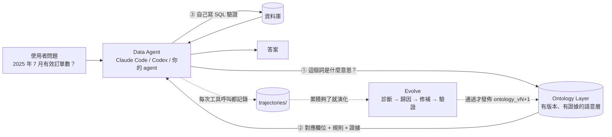

> 圖說：實線是「使用時」發生的事（agent 先查語意層，再自己查資料庫）；虛線是「演化」，由使用紀錄驅動語意層升版。
> 語意層是**指引不是答案**——它明說「Resolved mappings are guidance, not final answers」，agent 仍須自己查資料驗證。

### 2.2 三層結構：Content / Schema / Tool

EvoOntology 把「ontology 層」拆成三層。演化時可以針對其中一層修補，所以要先分清楚。

```text
┌──────────────────────────────────────────────────────────────────────┐
│ Tool Layer（怎麼取用）                                                 │
│   manifest（開場說明，約 15 行）                                        │
│   browse_semantics(query, kind, limit)   → 找「有哪些相關概念」，最多 6 筆 │
│   resolve_semantics(mentions, context)   → 把概念展開成欄位/關係/限制/證據 │
├──────────────────────────────────────────────────────────────────────┤
│ Schema Layer（允許長什麼樣）                                            │
│   5 種物件的欄位定義、5 種關係型別、哪些物件可以互相引用                  │
│   規則文件：skills/build-ontology/references/ontology-schema.md          │
├──────────────────────────────────────────────────────────────────────┤
│ Content Layer（存了什麼知識）                                           │
│   Term / Mapping / Relation / Constraint / Evidence 的實際內容          │
│   存成 versions/ontology_vN/ 下的 5 個 JSON 檔                          │
└──────────────────────────────────────────────────────────────────────┘
```

| 層 | 白話 | 演化時可能的修補 | 本 PoC 的例子 |
| --- | --- | --- | --- |
| Content | 知識本身 | 補概念、補別名、修錯誤定義 | 補上「訂單日期」別名 |
| Schema | 知識的格式 | 新增欄位或關係型別 | Mapping 只能指向單一欄位，表達不了跨表指標 |
| Tool | 取用方式 | 改檢索、改排序、改回傳內容 | 讓問題裡出現「7 月」就自動帶出時區規則 |

### 2.3 五種物件：用一個真實例子看

Content Layer 由五種物件組成（定義在 `evoontology/ontology/models.py`）。
下面是我們這次建出來的真實資料，以「訂單成立時間」為例：

| 物件 | 作用 | 這次的實例（節錄自 `workspace/.evoontology/versions/ontology_v0/`） |
| --- | --- | --- |
| **Term** 概念 | 一個業務名詞，含定義、別名 | `term_order_time`：「訂單成立時間」，type=dimension，別名 `order_ts`、`訂單時間`、`下單時間` |
| **Mapping** 對應 | 概念落在哪張表哪個欄位 | `map_order_time`：`orders.order_ts`，grain=「秒級時間戳（儲存值為 UTC，報表用台北時間）」 |
| **Relation** 關係 | 概念之間的連結，型別只有 5 種 | `rel_order_items`：訂單 `composition`（由…組成）訂單明細 |
| **Constraint** 限制 | 使用這個概念時必須遵守的規則 | `con_tz_order_time`：severity=**block**，「任何日期/月/季/年的劃分都要先換成台北時間」 |
| **Evidence** 證據 | 可重現的查詢與結果，證明上面的主張 | `ev_tz_period_impact`：換算時區會讓 655 張訂單換月 |

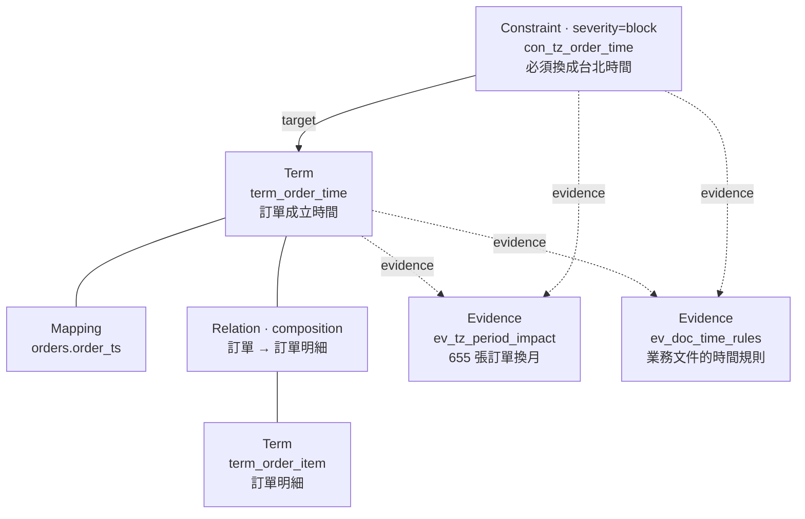

> 圖說：實線是語意關係或結構連結；虛線是「這個主張由哪些證據支撐」。
> 注意 Constraint 的 `target` 指向 Term——**這個方向決定了後面 resolve 能不能取到它**（2.7 節）。

幾個值得記住的設計細節（來自 `ontology-schema.md` 與 `models.py`）：

- **Relation 只有 5 種型別**：`association`（一般關聯）、`hierarchy`（is-a）、`composition`（part-of）、`equivalence`（等價）、`derivation`（衍生）。不允許自由文字如 `affects`。
- **Constraint 有 `severity`（block / warn / info）與 `trigger_keywords`**；這次建出 27 條，其中 block 17、warn 9、info 1。
- **每個物件都要有 Evidence 支撐**，Evidence 是「查詢 + 結果」，可以重跑。
- **語意層不放 SQL 範本或解題步驟**（skill 明文禁止）——它只描述「是什麼、在哪、有什麼規則」，不教 agent 怎麼解題。
- **最小化原則**：只建工作負載需要的概念。沒被問過的概念不會自動出現（這是後面取消率那題失分的原因）。

### 2.4 磁碟上長什麼樣：workspace

```text
.evoontology/
├── project.json            專案設定：mode、資料來源、評估方式
├── workload/questions.json 建構用的題目（去重、記錄來源）
├── versions/
│   └── ontology_v0/        每個版本一個資料夾，內含 5 個 JSON
│       ├── terms.json  mappings.json  relations.json
│       └── constraints.json  evidence.json
├── active.json             {"active_version": "ontology_v0"}  ← 目前啟用哪一版
├── state.json              演化觸發器的檢查點（上次演化到哪、門檻）
├── reports/ontology_v0.json  annotate 產生：摘要、限制、題目→物件連結
├── trajectories/           任務軌跡（每個任務的每次工具呼叫）  ← 本 PoC 是空的
├── evolution/run_N/        每次演化的 run.json / rounds.jsonl / evaluations/ ← 本 PoC 是空的
└── visualizations/         離線 HTML 探索器
```

### 2.5 完整生命週期

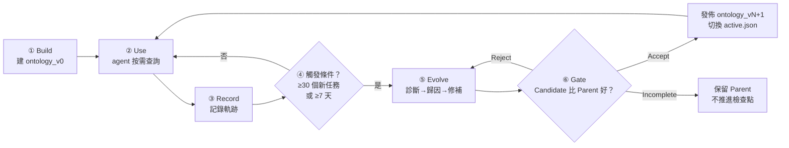

> 圖說：Build 只做一次；之後 Use → Record 循環，累積到觸發條件才進入 Evolve。
> Gate 的三種結果：Accept 發佈新版；**Reject 不結束，繼續在同一次 run 裡試下一個 Candidate**；Incomplete 只在預算用完或外部阻礙時發生。

**一個關鍵的分工原則**（`docs/architecture.md`）：Python core 只做「確定性」的事——儲存、檢索、記錄、驗證、狀態機；
**所有需要智慧的部分（建什麼概念、診斷、歸因、設計修補）都在 skill 裡，由 LLM 完成**。

| 誰做 | 負責 | 位置 |
| --- | --- | --- |
| Python core（固定程式） | 版本儲存、runtime 檢索、軌跡、觸發器、評估 Gate、演化狀態機、結構驗證、HTML 渲染 | `evoontology/` |
| Skill（LLM 照著做） | Build 的探勘與語意設計、Evolve 的診斷/歸因/修補 | `plugins/*/skills/` |
| MCP server | 把 core 的 28 個函式包成 stdio 工具，讓 Claude Code / Codex 能呼叫 | `evoontology/runtime/mcp_server.py` |

### 2.6 Build：怎麼建出 ontology_v0

`build-ontology` skill 把 Build 分成 Step 0 / 1 / 2。下圖標出每個動作是 LLM 還是固定程式（這是你改寫 pipeline 時最關心的）：

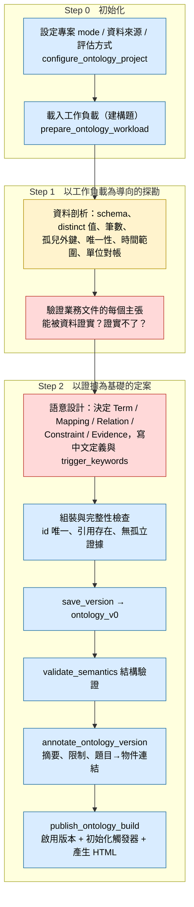

> 紅 = 必須 LLM；藍 = 固定程式；黃 = Builder 回報「可寫成固定程式」，但這次是 LLM 手寫 SQL 完成。

要點：

- `validate_semantics` 只檢查**結構**：五個檔案是合法 JSON、所有跨物件引用都存在、可被 runtime 載入。**通過不代表內容正確**。
- Build 的資料邊界有兩種模式（`project.json` 的 `mode`）：
  - `fixed_split`：有固定題庫與標準答案的 benchmark。資料先切成 Fold A / B，A 再切 70% 建構 + 30% 驗證，B 當最終測試；驗證集**不能流回**建構與診斷。
  - `rolling_trajectory`：正式環境或冷啟動，沒有固定測試集。用種子題建 v0，之後任務累積成軌跡，觸發演化時凍結一批再切 Evolution Pool / Validation Reserve。
  - **本 PoC 用 `rolling_trajectory`**，我另外自己切了建構題與留出題。
- 工作負載（題目）的來源優先序：使用者提供 > 專案歷史 > 由 Builder 依資料證據自行生成（填補覆蓋缺口）。Core **自己不生成題目**，只負責去重與記錄來源。

### 2.7 Use：agent 怎麼取用（這是 B 組失分的地方）

Agent 開場先看到 manifest（物件統計 + 兩個工具的用法，不含任何領域知識），之後靠兩個工具：

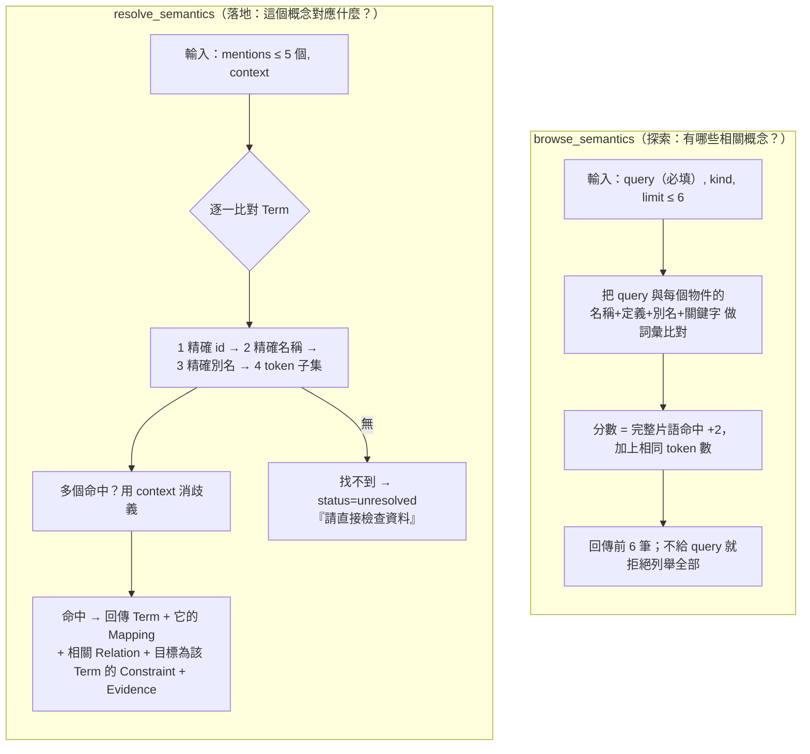

我在 PoC 裡直接呼叫 runtime 驗證了兩個行為，它們解釋了所有 B 組的錯誤：

| 呼叫 | 實際回傳 | 意義 |
| --- | --- | --- |
| `resolve(["訂單日期"])` | `status: unresolved`，「No active term matching '訂單日期'. Inspect the data directly.」 | ontology 裡叫「訂單成立時間」，沒有「訂單日期」這個別名 → **拿不到時區規則** |
| `resolve(["訂單成立時間"])` | `resolved`；回傳 1 個 mapping、**constraint `con_tz_order_time`（block）**、4 筆 evidence | 用對詞就一切都在 |
| `browse("淨營收", kind=all)` | 命中 7 筆（回傳前 6 筆） | 已建構的概念，短詞有效 |
| `browse("取消率", kind=all)` | 命中 1 筆，只是「已取消訂單」的 constraint，沒有「取消率」這個指標 | 沒被問過的概念是空的 |

**從原始碼讀到的三個檢索限制**（`runtime/runtime.py`）：

1. **Constraint 只有「目標是該 Term」才會被帶出來。** `trigger_keywords`（例如 constraint 裡列的「月份」「第一季」）**只在 `browse` 的搜尋文字裡用到**，`resolve` 不會因為問題提到「7 月」就自動回傳時區規則。
2. **中文沒有斷詞。** 切 token 用 `\w+`，一段連續中文是**一個** token。我實測：「2025 年 7 月有效訂單數是多少？」會被切成 `{'2025', '月有效訂單數是多少'}`，
   完全對不上「有效訂單」這個概念。所以整句中文問題幾乎不可能命中；短詞或子字串才有用，agent 必須自己把問題拆成短名詞。
3. **回傳數量有硬上限**（browse ≤ 6、resolve ≤ 5 個概念）——這是「按需取用」的設計，也意味著不能一次看全貌。

### 2.8 Evolve：自我演化怎麼運作

這是 EvoOntology 的標誌性功能（**本 PoC 沒有跑**，見第 4 章），這裡說明它的機制。

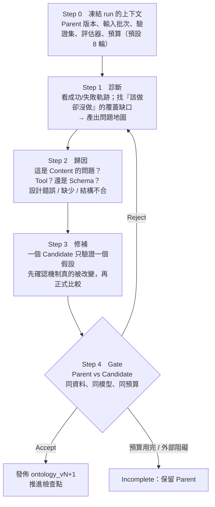

**Gate 的判準是程式碼寫死的**（`evaluation/evaluation.py`、`evolution/session.py`），不是 LLM 的主觀判斷：

| 評估方式 | 什麼時候用 | Accept 條件 |
| --- | --- | --- |
| Ground truth | 有標準答案 | Candidate 平均分**嚴格大於** Parent，且沒有「不可接受的退步」 |
| LLM Judge | 沒有標準答案 | Judge 匿名比較（A/B 隨機交換）；Candidate 勝場**嚴格多於** Parent，且 **0 個 critical error** |

演化狀態機的幾條硬規則（`session.py`）：

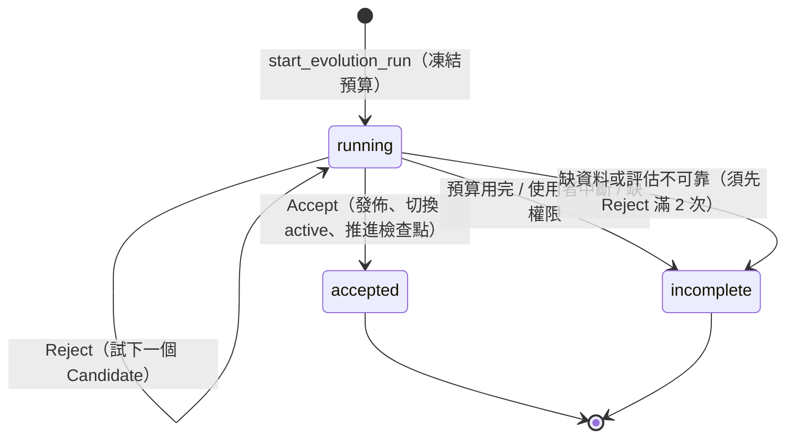

- 單一 Reject **不會**結束 run；至少要先 Reject 2 次，才允許因「缺資料/評估不可靠/外部阻礙」宣告 Incomplete。
- 修補不得動 benchmark 題目、標準答案、評估器、資料切分、驗收標準；知識必須存在有版本的語意物件中，不可藏在 prompt 裡。
- 觸發器（`trigger/trigger.py`）只決定「要不要提醒」，不會自動啟動演化：**新增 ≥30 個任務 或 距上次 ≥7 天**。

### 2.9 小結：把 EvoOntology 想成什麼

> **一份帶版本號、帶證據的「業務詞典」+ 兩個查字典的工具 + 一個靠使用紀錄來修訂詞典的流程。**
> 詞典只回答「這個詞是什麼、在哪個欄位、有什麼規則、憑什麼這樣說」，不回答問題本身。

---

## 3. PoC 做了什麼

### 3.1 目標與你指定的原則

**目標：** 先對 EvoOntology 能帶來的成果有初步感受，之後再深入讀 code、改寫成「deterministic pipeline + OpenRouter 開源模型」。

**驗收兩項：** (1) agent 在**沒看過的問題**上表現良好；(2) 能在 UI 上看到建出來的 ontology。

**你指定的原則與我怎麼遵守：**

| 原則 | 做法 |
| --- | --- |
| 不污染機器環境 | 一切在 `poc/` 底下。用機器上**本來就有**的 uv 與 Python 3.12 建 `poc/.venv`，**零第三方套件**；所有指令加 `PYTHONDONTWRITEBYTECODE=1`。**沒有安裝 plugin 到 `~/.claude`** |
| 不無腦執行 plugin | 讀 code 後發現 plugin 的 MCP server 只是一層轉接，真正的實作是 `ops._HANDLERS` 裡 28 個 Python 函式；我寫 `tools/ops.py` 用同一個註冊表直接呼叫 |
| 每階段留記錄 | 本報告 + `poc/_private/POC_LOG.md`（逐階段詳細記錄） |
| 不 commit | `git status` 只有未追蹤的 `poc/`，repo 追蹤的檔案零改動 |

### 3.2 實驗架構

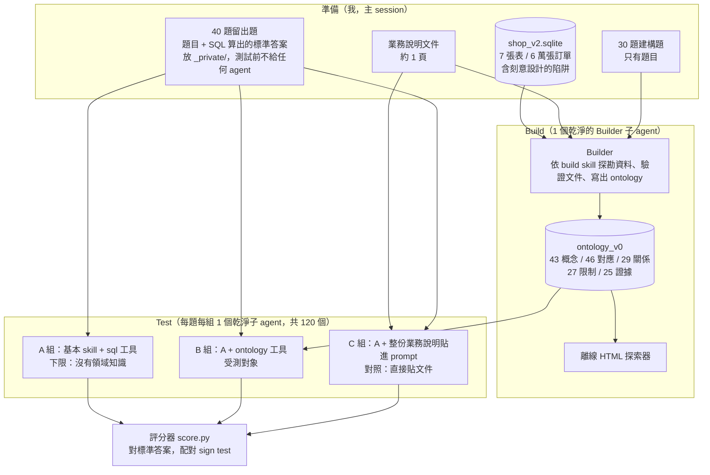

> 關鍵設計：**建構題與留出題完全分開**。Builder 只看過 30 題建構題；40 題留出題在 Build 完成後才拿來測，所以測的是「對沒看過的問題」的泛化。

### 3.3 場景與資料：Lumo Outdoors 戶外裝備電商

- SQLite，**7 張表、6 萬張訂單、約 10.5 萬筆明細**；**刻意不宣告外鍵、不加欄位註解**（很多企業資料庫就是這樣）。
- 資料由 `_private/gen_data_v2.py` 以固定 seed 產生，可重現。

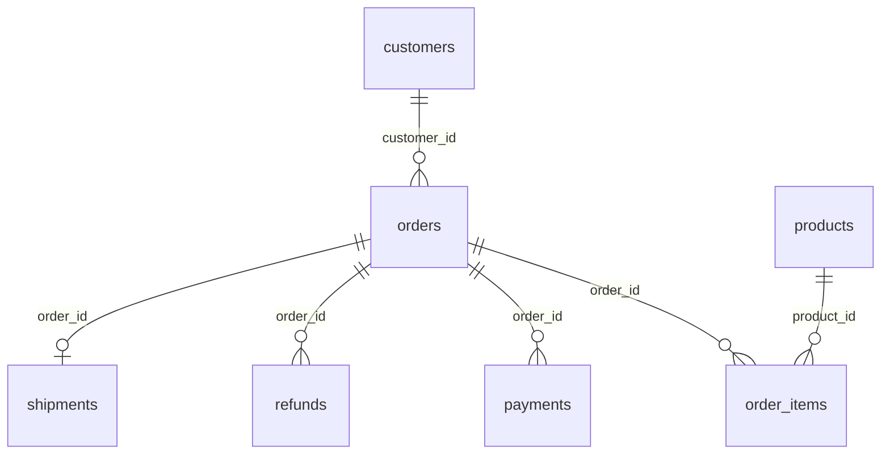

> 圖說：這些關聯在資料庫裡**沒有宣告**，是 agent / Builder 從欄位命名和資料推斷出來的。

**我刻意埋的陷阱**（這是我設計的，結果要打折看）：

| 陷阱 | 業務說明有寫？ | 只能靠探索資料發現？ |
| --- | --- | --- |
| 時間戳是 UTC，報表用台北時間（跨月/跨年邊界） | 有 | 否 |
| 狀態碼 0/1/2/3/9 的意義 | 有 | **是**（資料裡沒有對照表） |
| 有效訂單、淨營收、客單價、回購客戶的定義 | 有 | 否 |
| 淨營收按「訂單時間」歸屬，退款報表按「退款時間」歸屬 | 有 | 否 |
| 金額單位不一致：`order_items.unit_price_cents` 是 1/100 元，其他表是元 | **沒有** | **是** |
| 一張訂單可有多筆付款（失敗重試），只有 `ok` 才算實收 | 代碼有寫，重試現象沒寫 | **是** |
| 配送時數依物流商不同；`shipments` 只有已出貨/已送達的訂單才有紀錄 | 部分 | 部分 |

**題目的三種分組**（用來判斷 ontology 的泛化邊界）：

| 分組 | 題數 | 意義 | 例子 |
| --- | ---: | --- | --- |
| `near` | 20 | 與建構題同一類概念，只換參數 | 換成別的季度、地區、會員等級 |
| `far_combo` | 10 | 已見概念的新組合 | 北部且黃金會員、帳篷第二季淨營收 |
| `far_unseen` | 10 | 文件有定義、但建構題**完全沒問過**的指標 | 取消率、配送天數、優惠碼訂單數 |

標準答案**不靠人工**：由 `_private/make_questions_v2.py` 直接對資料庫跑 SQL 算出，並檢查每題結果唯一。
我也修過幾題「容易被猜中」的題目（例如答案都是 tent 的兩題）。評分容忍度：金額相對 0.05%、計數須完全相等、比率與平均值容許 0.06。

### 3.4 Build 實際發生了什麼

派一個乾淨的 Builder 子 agent（代表未來的 OpenRouter 模型），耗時約 **8.4 分鐘、33 次工具呼叫**：

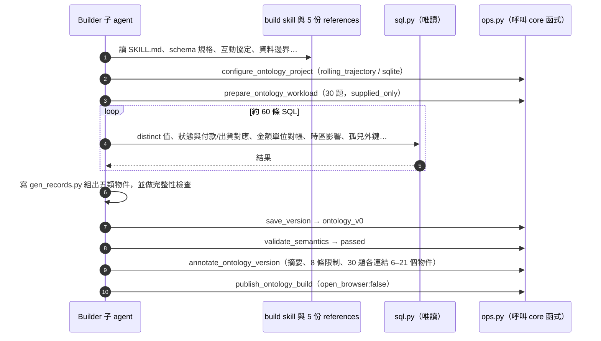

**產出**：43 個 Term、46 個 Mapping、29 個 Relation、27 個 Constraint、25 個 Evidence。

| 類別 | 分布 |
| --- | --- |
| Term 型別 | entity 6、dimension 15、metric 8、concept 4、category 10 |
| Relation 型別 | hierarchy 15、derivation 9、composition 3、association 2、equivalence 0 |
| Constraint 型別 | enum_semantics 10、business_rule 9、scope 7、data_quality 2、unit 1 |

**Builder 自己從資料裡發現、並寫成證據的事實（沒有人告訴它）：**

- 金額單位：`order_items` 的價格是「分」，其他表是「元」。（v1 試跑時它的驗證方式是：把有效訂單的明細加總去對該單的成功付款，全部吻合。）
- 時區換算會讓 **655 張訂單換月**（例如 2025/3 的有效訂單是 4128 還是 4144，取決於是否換算）。
- 付款有失敗重試，失敗的付款列仍帶金額，不能算實收；訂單狀態與付款、出貨紀錄能互相印證。
- 下架商品仍有歷史銷售；客戶姓名會重複。

**Builder 對文件主張的判斷（值得注意）：**

- 文件說「成交價已含優惠碼折扣」。Builder 驗證後發現成交價對標價的比例（100/90/85/80）和是否使用優惠碼**沒有關聯** → **不建優惠碼物件**，只在限制裡註明。這是「不採信資料佐證不了的主張」的實例。
- UTC 時區只有文件支持、資料本身無法證實（訂單小時分布近似均勻）→ confidence 設 medium。

**沒有被放進 ontology 的**（依最小化原則）：整張 `shipments` 表、取消率、配送天數、準時送達、新註冊客戶、優惠碼、待出貨訂單。
與 `far_unseen` 題幾乎完全重疊——這是預期中的覆蓋缺口。

**環境問題與越界（如實記錄）：**

- `sql.py` 當時的執行量上限太緊，約 5 次大型查詢被中斷，4 項 Evidence 只涵蓋取樣範圍。測試前我已把上限放寬，**ontology 沒有重建**。
- Builder 有一次用系統 `python3` 對自己的腳本做字串替換，沒碰資料庫或 ops，屬輕微越界。

### 3.5 測試組別

| 組 | 內容 | 用意 |
| --- | --- | --- |
| **A** | 基本 skill + `sql.py`（可看 schema） | 下限：沒有任何領域知識 |
| **B** | A + `ontology.py`（browse / resolve；manifest 放進 skill） | **受測對象** |
| **C** | A + 整份業務說明貼進 skill（無 ontology） | 對照：「直接貼文件」這個最簡單的做法 |

每個子 agent 只能讀自己的 skill 檔，只能用 `sql.py`（授權器只允許 SELECT）、`ontology.py`（B 組）、`submit.py`。
**軌跡由工具自己寫檔**，不依賴 agent 自述，所以事後可以客觀看每個 agent 實際做了什麼。
40 題 × 3 組 × 1 次 = 120 個乾淨子 agent；以「同一題兩組是否都答對」做配對比較（sign test，雙尾）。

### 3.6 結果

**依題型分的正確率：**

| 組別 | 全部（40） | near（20） | far_combo（10） | far_unseen（10） |
| --- | ---: | ---: | ---: | ---: |
| A 什麼都沒有 | 62% | 45% | 80% | 80% |
| B 有 ontology | **90%** | 90% | 100% | 80% |
| C 說明貼進 prompt | **100%** | 100% | 100% | 100% |

**配對比較（同一題）：**

| 比較 | 只有左邊對 | 只有右邊對 | p 值 | 解讀 |
| --- | ---: | ---: | ---: | --- |
| A vs B | 0 | **11** | 0.001 | ontology 顯著有幫助，且**從未讓原本對的題變錯** |
| A vs C | 0 | **15** | <0.001 | 貼文件顯著有幫助 |
| B vs C | 0 | 4 | 0.125 | **分不出 B 與 C 的差距**（樣本太小），但方向偏向 C |

**每題的結果**（40 題中 25 題三組都對，下表只列有任何一組答錯的 15 題）：

| 題 | 類型 | A | B | C | B 錯的原因 |
| --- | --- | :-: | :-: | :-: | --- |
| H01 H02 H03 H04 H05 | near | ❌ | ✅ | ✅ | |
| H13 H14 H18 H19 | near | ❌ | ✅ | ✅ | |
| H22 H24 | far_combo | ❌ | ✅ | ✅ | |
| **H09** 7 月有效訂單數 | near | ❌ | ❌ | ✅ | 沒換台北時間（查「訂單日期」未命中） |
| **H10** 門市有效訂單數 | near | ❌ | ❌ | ✅ | 同上 |
| **H37** WELCOME10 訂單數 | far_unseen | ❌ | ❌ | ✅ | 同上 |
| **H32** 取消率 | far_unseen | ❌ | ❌ | ✅ | 分母定義不在 ontology |

**軌跡統計（各組工具呼叫總數）：**

| 組 | SQL 次數 | SQL 出錯 | 語意層呼叫 | 備註 |
| --- | ---: | ---: | ---: | --- |
| A | 381 | 22 | — | 每個 agent 都說「狀態碼沒說明，是我推測的」 |
| B | 138 | 2 | 96（40 題每題都用） | 其中 21 次 resolve 回 unresolved、8 次 browse 為空 |
| C | 160 | 0 | — | |

B 用的 SQL 次數約為 A 的 36%，而且幾乎沒有試錯——**ontology 省下的是摸索成本**。

### 3.7 為什麼 A 錯、為什麼 B 錯

**A 組錯 15 題：** 每個 agent 都得自己猜狀態碼的意義，而且猜得**不一致**——有的只算狀態 3、有的排除狀態 9、有的排除 0 和 9。
其餘是沒換台北時間、淨營收的退款歸屬、把客單價算成實付金額。這正是沒有領域知識造成的不穩定。

**B 組錯 4 題**——我逐題查了軌跡與驗證指令：

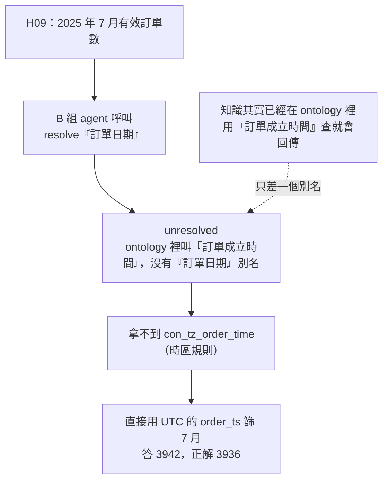

| 根因 | 影響題數 | 屬於哪一層 | 怎麼修（尚未做） |
| --- | ---: | --- | --- |
| 取用靠 agent 猜對詞：沒有「訂單日期」別名；`trigger_keywords` 不會被 resolve 用到 | 3（H09、H10、H37） | Tool（+ Content 補別名） | 補別名；或讓 resolve 對整句問題做關鍵字比對、自動帶出相關 constraint；或把「全域規則」（時區、有效訂單）放進 manifest |
| 沒被問過的定義沒進 ontology（取消率的分母要扣掉待付款） | 1（H32） | Content（最小化原則的代價） | 需要另一個入口讓文件裡的定義進來，或靠演化補上 |

> 這兩類正是 EvoOntology 的 **Evolve** 設計要處理的問題（診斷出缺口 → 補 Content / 改 Tool）。**我是手動做了這個診斷，但沒有跑 Evolve 去修**（第 4 章）。

### 3.8 判讀

1. **ontology 確實有幫助。** 在這個場景下，B 比 A 多對 11 題、沒有任何一題變差，而且試錯大幅減少。
2. **但 B 沒有贏過「直接貼文件」。** 這個規模（7 張表、1 頁說明）本來就貼得進 prompt，貼文件是更簡單也更強的做法。
   **這個 PoC 沒有測到 ontology 真正的賣點**：當知識多到無法整份貼進 prompt 時，按需檢索才會有優勢。
3. **B 的失分有兩個來源，都可以改進**：取用方式太脆弱（詞彙比對）、以及最小化原則造成的覆蓋缺口。
4. **`far_unseen` 沒有鑑別力**（A、B 都是 80%）：那 10 題大多可以直接從資料算出來，文件定義影響小。
   原本想用它檢驗「ontology 對沒問過的概念無幫助」，結論只能說「沒有看到幫助」，不能說「證明沒有」。

### 3.9 其他做過的事

**v1 試跑（已歸檔在 `poc/pilot_v1/`）。** 先用 6 張表、10 題建構題、10 題留出題跑了一次完整 Build，驗證流程可行，也暴露了 skill 規格不明的地方
（`save_version` 的參數形狀沒寫、同版本可被覆寫、Evidence 欄位型別不明、Mapping 只有單一欄位表達不了跨表指標、
`hierarchy` 被拿來表示子集合、文件算不算「外部知識」沒說明等）。
因為留出題只有 10 題，差 1–2 題就是雜訊，所以你要求放大規模，正式實驗改用 v2。v1 結果**不納入**上面的統計。

**規模測試（已中止並清除）。** 為了測「知識多到貼不進 prompt」，我建了更大的版本：31 張表（v2 的 7 張 + 24 張新表，分 6 個主題）、約 3.9 萬字的業務文件、
48 題留出題，並多一組 D（文件查詢工具：目錄/讀取/搜尋，不貼全文）。ontology 用 map-reduce 方式建（各主題一個 Builder 平行建，再用固定程式合併）：230 個概念、291 個對應、261 個關係。
你因為 token 成本太高要求取消，我停掉所有 agent，並刪除 `poc/scale/`（33 MB）。**這部分沒有留下任何可重現的檔案。**

中止前跑完的部分（64 次執行、16 題、只涵蓋 3 個主題）：

| 組 | 正確率 |
| --- | ---: |
| A 什麼都沒有 | 56% |
| B ontology | 100% |
| C 整份文件貼進 prompt | 100% |
| D 文件查詢工具 | 100% |

**這只能看出方向，不能下結論：** 只有 16 題、1 次/題；3.9 萬字的文件**仍放得進 context**，所以並沒有真正測到「貼不進去」；
B 組有一題是 agent 把「送出答案」和最後一個查詢並行執行而交了猜測值（剛好在容忍範圍內）；
另有 2 題的標準答案被發現逐字出現在 ontology 的證據裡，已排除。
**唯一站得住腳的觀察：** 「有領域知識」遠勝「沒有」；B、C、D 在這個規模分不出差別。

---

## 4. PoC 涵蓋了哪些步驟、哪些沒有

### 4.1 一張圖看覆蓋

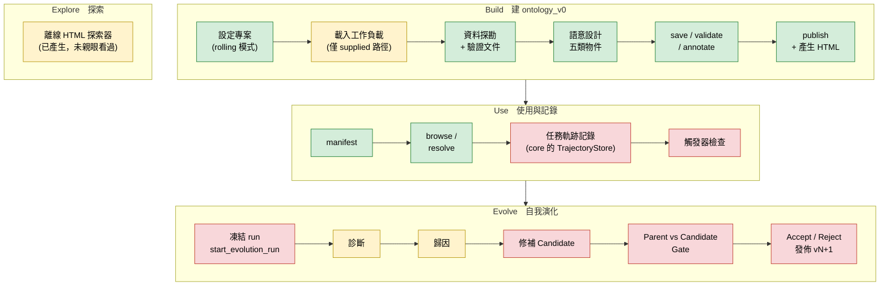

> 綠 = 已涵蓋；黃 = 部分涵蓋；紅 = 沒有涵蓋。

### 4.2 逐步對照表

| 階段 | 步驟 | 對應的 core 函式 / skill | 狀態 | 這次實際怎麼做 |
| --- | --- | --- | :-: | --- |
| Build | 解析並保存專案設定 | `configure_ontology_project` | ✅ | Builder 呼叫；mode=`rolling_trajectory` |
| Build | 資料邊界：`fixed_split`（Fold A/B、70/30） | skill Step 0 | ❌ | 沒用。我自己切建構題/留出題，不是 EvoOntology 的切法 |
| Build | 載入工作負載：使用者題目 | `prepare_ontology_workload` | ✅ | 30 題，`supplied_only:true` |
| Build | 載入工作負載：專案歷史、Builder 自行生成題目（冷啟動） | 同上 `history` / `generated` | ❌ | 沒走這兩條路徑 |
| Build | Step 1 以工作負載導向探勘資料、驗證文件主張 | skill Step 1 | ✅ | Builder 約 60 條 SQL |
| Build | Step 2 語意設計：五類物件 | skill Step 2 | ✅ | 43/46/29/27/25 |
| Build | `save_version` → `validate_semantics` | core | ✅ | 一次通過 |
| Build | `annotate_ontology_version` | core | ✅ | 30 題各連結 6–21 個物件 |
| Build | `publish_ontology_build`（啟用、初始化觸發器、渲染 HTML） | core | ✅ | `open_browser:false` |
| Use | manifest + `browse_semantics` + `resolve_semantics` | `runtime/runtime.py` | ✅ | 用同一份 `SemanticLayer` 類別，包成 CLI 給測試 agent（**不是**走 MCP stdio） |
| Use | MCP server（stdio JSON-RPC）本身 | `runtime/mcp_server.py` | ❌ | 刻意不啟動，直接 import 函式 |
| Record | 任務軌跡寫入 `trajectories/` | `start_ontology_task` / `finish_ontology_task` 等 | ❌ | 用我自己的 `eval/runs/*.jsonl` 記錄；`trajectories/` 是空的 |
| Record | 演化觸發器 | `EvolutionTrigger`、SessionStart hook | ❌ | 只在 publish 時初始化了 `state.json` |
| Evolve | Step 0 凍結 run | `start_evolution_run` | ❌ | `evolution/` 是空的 |
| Evolve | Step 1 診斷（問題地圖） | evolve skill | 🟡 | **我手動**逐題查了 B 的 4 個錯誤，沒有用 skill、沒有產生問題地圖 |
| Evolve | Step 2 歸因（Content / Tool / Schema） | evolve skill | 🟡 | 手動歸因：Tool（檢索）+ Content（別名、覆蓋）；沒有競爭假設與驗證 |
| Evolve | Step 3 修補 Candidate | evolve skill | ❌ | 沒有修補、沒有 `ontology_v1` |
| Evolve | Step 4 Parent vs Candidate Gate | `EvaluationGate` | ❌ | 我做的是「有無 ontology / 貼文件」的比較，**不是** Parent 對 Candidate |
| Evolve | Accept / Reject / Incomplete、發佈、檢查點 | `EvolutionSession` | ❌ | — |
| Evolve | 演化 Schema 層、Tool 層（不只 Content） | evolve skill | ❌ | — |
| Evaluate | Ground-truth 評估 | adapter + `decide_gt` | 🟡 | 用 GT 評分了，但沒經過 `EvaluationGate` |
| Evaluate | LLM Judge（無標準答案時） | `decide_judge`、A/B 匿名 | ❌ | — |
| Explore | `visualize_ontology` 離線 HTML | `visualization/` | 🟡 | 檔案已產生；**我沒開瀏覽器看過** |
| 整合 | Codex plugin | `plugins/evoontology-codex/` | ❌ | — |
| 整合 | 官方 benchmark（BIRD / DDR-10K / InsightBench）與 `EvolutionAdapter` | `benchmarks/` | ❌ | — |

### 4.3 統計

在上表 25 個步驟中：**✅ 完整涵蓋 8 個、🟡 部分涵蓋 4 個、❌ 未涵蓋 13 個。**
（「步驟」是我依 skill 與 core 的流程拆的，粒度是我定的，所以數字只用來看比例，不是官方的步驟數。）

用一句話說：**這個 PoC 完整驗證了 Build → Use 這半邊（EvoOntology 的「靜態語意層」），完全沒有驗證 Evolve 這半邊（它的「自我演化」賣點）。**

### 4.4 這個缺口代表什麼

- 我們得到的結論（「ontology 比沒有好、沒有比貼文件好」）**只適用於 v0 的靜態語意層**。
  EvoOntology 主張的價值——ontology 會隨使用越變越好——**完全沒被驗證**。
- 有一個很自然的 Evolve 實驗入口：B 組那 4 個錯誤本身就是一份現成的「問題地圖」。
  但要注意：**這 40 題留出題已經被我拿來診斷了**，如果拿同一批題目驗證 Candidate，就違反 EvoOntology 自己的資料邊界原則
  （驗證集不能流回診斷）。要做 Evolve 實驗，必須準備一批**新的**驗證題。
- 軌跡記錄（Record）沒走 core 的 TrajectoryStore，意味著「軌跡格式」「觸發條件」這些 Evolve 的輸入端也沒測到。

---

## 5. 對改寫成 deterministic pipeline 的啟示

> 你的長期目標是把 repo 改寫成「固定流程 + 開源模型（OpenRouter）」。以下是這次實測與讀 code 的收穫。

### 5.1 哪些步驟可以寫死、哪些必須用 LLM

| 步驟 | 誰做 | 說明 |
| --- | --- | --- |
| 設定專案、載入工作負載 | 固定程式 | 純參數與去重 |
| 資料剖析：schema、distinct 值、筆數、孤兒外鍵、唯一性、時間範圍 | **可固定程式** | Builder 自己也回報這些都能寫死 |
| 代碼表（enum）骨架：低基數欄位的 distinct 值 | **可固定程式** | 對照文件代碼表由 LLM 補意義 |
| 時區邊界影響量化、單位對帳 | **可固定程式** | 需要 LLM 先提出「該檢查什麼」 |
| 題目 → 物件的連結（links） | **可固定程式** | 關鍵字比對，LLM 只審核 |
| 業務文件的每個主張對資料驗證 | **LLM** | 要設計驗證查詢、判斷證據是否足以支持 |
| 語意設計：建哪些概念、型別、關係、寫中文定義與 `trigger_keywords` | **LLM** | 核心智慧部分 |
| 組裝、完整性檢查、save / validate / annotate / publish | 固定程式 | 都在 `ops._HANDLERS` |
| Use 階段的 browse / resolve | 固定程式 | 純詞彙比對，可直接 import `SemanticLayer` |

你的 pipeline **不需要 MCP**：直接 `import evoontology.runtime.ops` 即可，MCP 只是為了讓 Claude Code / Codex 能呼叫。

### 5.2 規模建構的經驗（來自已清除的規模測試）

- **按主題分給多個 Builder 平行建、再用固定程式合併**是可行的，比單一 Builder 吃下 31 張表更可控。
- Builder 即使沒人要求，也會在證據裡**寫進答案類的數字**（2 題的標準答案逐字出現在 ontology 證據）→ pipeline 需要「洩漏檢查」步驟。
- Agent 會把「送出答案」和最後一個查詢並行，交出猜測值 → 測試線束要強制順序。

### 5.3 改寫前需要先決定的設計問題

1. **檢索太脆弱**（見 2.7）：要不要對整句問題做關鍵字比對並自動帶出 constraint？要不要中文斷詞？別名如何補全？
2. **「最小化」原則 vs 覆蓋**：沒被問過的定義不會進 ontology。若業務定義很多，需要另一個入口讓它們進來。
3. **Mapping 只有單一 table/column**：跨表衍生指標（淨營收）只能靠文字欄位與 derivation relation 拼出來。
4. **skill 規格不明處**（Builder 回報）：`save_version` 參數形狀、同版本可否覆寫、Evidence 欄位型別、文件類證據的格式、
   Term `type` 與 Relation 型別的邊界、`aggregation_semantics` 與「不寫 SQL」的界線。固定 pipeline 需要先把這些寫成明確規則。
5. **Python 版本**：repo 要求 `>=3.10`，系統 Python 是 3.9；這次用機器上既有的 uv Python 3.12。
6. **開源模型的 Builder 品質**未知：本 PoC 的 Builder 與測試 agent 都是 Claude Sonnet 5.5。

---

## 6. 限制與誠實說明

| 限制 | 影響 |
| --- | --- |
| 資料、陷阱、題目都是我設計的 | 結果代表「這類情境下機制能運作」，不代表你公司真實資料的效果 |
| 每題每組只跑 **1 次** | 無法分離模型抽樣雜訊；p 值只是方向性訊號 |
| Builder 與所有測試 agent 都是同一個模型 | 換成開源模型，ontology 品質和使用方式可能差很多 |
| 隔離只靠「告知不要讀」，沒有技術強制 | 子 agent 其實有檔案存取權；agent 自述都只讀了 skill 檔，我沒有逐一核對讀檔紀錄 |
| 7 張表、1 頁說明，貼得進 prompt | **沒有測到 ontology 的主場**（知識大到貼不進去） |
| 規模測試只有部分結果且已刪除 | 只能當方向參考，沒有可重現的檔案 |
| `sql.py` 上限在 Build 時過緊 | 4 項 Evidence 只涵蓋取樣範圍，ontology 沒有重建 |
| 我沒有親眼看過 UI 畫面 | 驗收 2 只確認了「檔案已產生且內嵌 ontology 內容」 |
| 只驗證 Build + Use，沒跑 Evolve | EvoOntology 的自我演化賣點完全未驗證（第 4 章） |

---

## 7. 建議的下一步

| 優先 | 做什麼 | 成本 | 為什麼 |
| :-: | --- | --- | --- |
| 1 | **打開 UI 看一次**（`workspace/.evoontology/visualizations/ontology-layer-explorer.html`），最好請懂業務的人看關係合不合理 | 極低 | 驗收 2 還欠你一個親眼確認；業務人員能發現我看不出的錯誤 |
| 2 | **修檢索後重跑 B 組**：補別名、讓 resolve 自動帶出相關 constraint，只重跑 4 個錯題 + 幾題對照 | 低 | 驗證「失分是取用問題而非知識問題」這個假設；也是最便宜的 Evolve 前哨 |
| 3 | **跑一次真正的 Evolve**（準備一批**新的**驗證題，用 skill 走完診斷→歸因→修補→Gate） | 中 | 補上 4.3 節最大的缺口，驗證自我演化 |
| 4 | **重複跑**（每題每組 ≥3 次） | 中 | 分離抽樣雜訊，讓 B vs C 的 p 值有意義 |
| 5 | **縮小版規模測試**：只選 1–2 個主題、文件真的大到貼不進 context、每組少跑幾題 | 中高 | 這才是 ontology 與「貼文件」真正比較的地方；上次因成本中止 |
| 6 | **換成開源模型當 Builder / 測試 agent** | 視模型 | 你的最終目標；先確認 ontology 品質在開源模型上是否站得住 |

---

## 8. 附錄

### 8.1 名詞表

| 名詞 | 意思 |
| --- | --- |
| Ontology Layer（語意層） | 帶版本、帶證據的業務知識庫，用 5 種物件表示 |
| Term / Mapping / Relation / Constraint / Evidence | 概念 / 對應到欄位 / 概念間關係 / 使用規則 / 可重現的證據 |
| Parent / Candidate | 演化時，現行版本 / 提議的新版本 |
| Gate | Candidate 能否取代 Parent 的程式化判準 |
| MCP | Model Context Protocol，讓 agent 呼叫工具的標準介面 |
| GT | Ground Truth，標準答案 |
| Builder | 負責建 ontology 的 LLM agent |
| near / far_combo / far_unseen | 留出題的三種分組（見 3.3） |
| 留出題（held-out） | 建構時完全沒看過、只用來測試泛化的題目 |
| sign test | 配對符號檢定：只看「兩組結果不同的題」誰多 |

### 8.2 檔案導覽（全部在 `poc/` 底下）

| 路徑 | 內容 |
| --- | --- |
| `workspace/.evoontology/visualizations/ontology-layer-explorer.html` | **UI**：單一離線 HTML，雙擊用瀏覽器開啟 |
| `workspace/.evoontology/versions/ontology_v0/` | 建出來的 ontology（5 個 JSON） |
| `workspace/.evoontology/reports/ontology_v0.json` | annotate 產生的摘要、限制、題目→物件連結 |
| `workspace/build_scratch/` | Builder 當時寫的產生腳本與 records |
| `data/shop_v2.sqlite` | 假資料（7 張表、6 萬張訂單） |
| `build_input_v2/` | Builder 的輸入：30 題建構題 + 業務說明 |
| `tools/` | 子 agent 用的工具：`sql.py`（唯讀）、`ontology.py`（browse/resolve）、`ops.py`（plugin 背後的函式）、`submit.py` |
| `eval/prompts/{A,B,C}.md` | 三組的 skill 檔 |
| `eval/answers.jsonl`、`eval/runs/*.jsonl` | 120 個答案與每次工具呼叫的完整軌跡（`BUILD.jsonl` 是 Builder 的） |
| `pilot_v1/` | v1 試跑的歸檔 |
| `_private/` | 資料產生器（含陷阱）、標準答案、評分器、`POC_LOG.md`（逐階段詳細記錄）、`POC_REPORT_old_v1.md`（改寫前的舊版報告） |
| `.venv/` | Python 3.12 虛擬環境（符號連結到機器上既有的直譯器），零第三方套件 |

> `_private/` 內含標準答案與陷阱設計，測試時不給 agent 看。

### 8.3 如何重現

```bash
# 重新評分（含每題明細）
PYTHONDONTWRITEBYTECODE=1 poc/.venv/bin/python poc/_private/score.py --per-question

# 重新產生資料與題目（固定 seed）
PYTHONDONTWRITEBYTECODE=1 poc/.venv/bin/python poc/_private/gen_data_v2.py
PYTHONDONTWRITEBYTECODE=1 poc/.venv/bin/python poc/_private/make_questions_v2.py
```

### 8.4 讀 code 時的重點檔案

| 想理解 | 讀這個 |
| --- | --- |
| 五種物件的欄位 | `evoontology/ontology/models.py`、`plugins/claude-code/skills/build-ontology/references/ontology-schema.md` |
| 版本怎麼存 | `evoontology/ontology/store.py` |
| browse / resolve 演算法 | `evoontology/runtime/runtime.py` |
| 28 個可呼叫函式 | `evoontology/runtime/ops.py`（`_HANDLERS`） |
| Build 怎麼做 | `plugins/claude-code/skills/build-ontology/SKILL.md` |
| Evolve 怎麼做 | `plugins/claude-code/skills/evolve-ontology/SKILL.md` |
| 演化狀態機 | `evoontology/evolution/session.py` |
| Gate 判準 | `evoontology/evaluation/evaluation.py` |
| 觸發條件 | `evoontology/trigger/trigger.py` |
| 整體架構 | `docs/architecture.md` |
