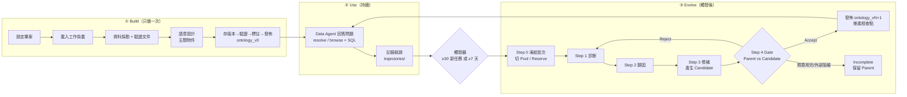
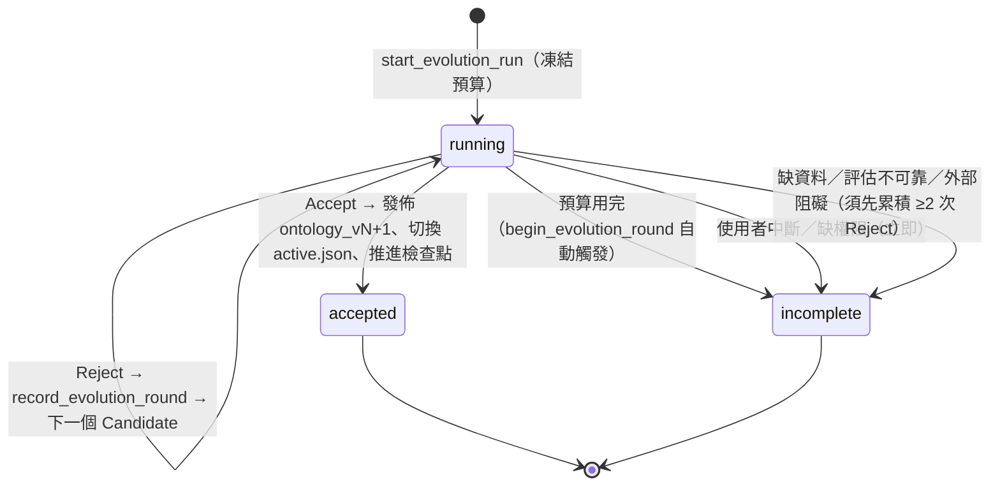

## 2. EvoOntology 到底怎麼運作（完整機制）

> 這一章整理「官方 plugin 的每一步實際發生什麼事」。依據是 repo 的原始碼與 skill 文件，每一點都標了出處，
> 讓你重寫時可以直接對照。第 3 章再說明「本 PoC 的 pipeline 如何把這些步驟變成 Python 程式」。

### 2.1 一句話與全貌

EvoOntology 把「業務知識」存成一份**有版本號、有證據的語意層（ontology layer）**，讓 Data Agent 用兩個工具按需查詢；
再用 Agent 的使用軌跡，定期**提出修補 → 與舊版比較 → 通過才發佈新版**，讓語意層自己變好。



### 2.2 workspace 與檔案：每一步在磁碟上留下什麼

`.evoontology/` 是整個系統的狀態（程式碼：`evoontology/workspace.py`、`ontology/store.py`）：

| 路徑 | 誰寫入 | 內容 |
| --- | --- | --- |
| `project.json` | Build Step 0（`configure_ontology_project`） | `mode`（`fixed_split`／`rolling_trajectory`）、資料來源、工作負載來源、評估方式（`llm_judge`／外部評估器）、資料邊界 |
| `workload/questions.json` | `prepare_ontology_workload` | 建構題，去重並記錄來源（user＞history＞generated） |
| `versions/ontology_vN/` | `save_version`／`accept_evolution` | 5 個 JSON：terms／mappings／relations／constraints／evidence |
| `versions/vN-cK/` | 演化時 `save_version` | **Candidate**：第 K 個從 vN 演化出的候選；Gate 通過前不得動 `active.json` |
| `active.json` | `publish_ontology_build`／`accept_evolution` | `{"active_version": "ontology_v1"}`，Agent 預設載入的版本 |
| `state.json` | `publish_ontology_build` 初始化、`accept_evolution` 推進 | 演化觸發器的檢查點：`checkpoint_trajectory`、`checkpoint_time`、`thresholds`（預設 30 個任務／7 天） |
| `reports/<version>.json` | `annotate_ontology_version` | 摘要、已知限制、題目→語意物件的連結 |
| `trajectories/<task_id>.json` | Data Agent 端（adapter）呼叫 `TrajectoryStore.append` | 每個任務一檔：問題、版本、語意呼叫（輸入+結果）、原生工具呼叫（結果截斷到約 2 KB／20 行）、最終答案、狀態、錯誤；**不存思考鏈** |
| `evolution/run_N/run.json` | `start_evolution_run` 起，每次狀態變更都更新 | 狀態（running／accepted／incomplete）、Parent、目前 Candidate、輪數、**凍結的預算**、驗收標準、`accepted_version`、`end_reason` |
| `evolution/run_N/rounds.jsonl` | `record_evolution_round` | 每個被拒絕的輪次一行：假說、Candidate、指標、決定、備註 |
| `evolution/run_N/evaluations/` | `record_evolution_evaluation` | Parent／Candidate 正式評估的穩定摘要，含 **`gate_input`** |
| `evolution/run_N/trajectory-sources.json` | `confirm_trajectory_sources` | 這次 run 用到的軌跡來源（只記路徑，不複製檔案） |
| `visualizations/*.html` | `visualize_ontology`／`finalize_evolution_run` | 離線 HTML 探索器，可切換版本並排比較 |

### 2.3 Build（簡述；細節見 PoC 1 報告第 2.6 節）

Build 把題目與資料變成 `ontology_v0`。skill 把它分成：

1. **Step 0** 解析並保存專案設定、載入工作負載（使用者題目＞專案歷史＞由資料證據生成的題目，Core 自己不生成題目）。
2. **Step 1** 以工作負載為導向探勘資料：逐一驗證業務文件的主張、檢查候選欄位、記錄「為什麼不選競爭欄位」；資料無法佐證的主張不得直接採信。
3. **Step 2** 產生 Term／Mapping／Relation／Constraint／Evidence；驗證；保存；標註；發佈。
   物件只能含 schema 定義的欄位，**不得放 SQL 範本或解題步驟**；Constraint 必須有 `trigger_keywords`。

發佈後 `state.json` 的觸發器被初始化，`ontology_v0` 成為 active。

### 2.4 Use 與 Record：Evolve 的原料從哪來

Agent 開場看到 manifest（物件統計 + 工具說明），之後用 `resolve_semantics`／`browse_semantics` 取得欄位對應與規則，再自己寫 SQL 驗證。
每個任務結束後，由 Agent 執行端（官方的 benchmark adapter，或 host agent 呼叫 `start/finish_ontology_task`）把任務寫成一份**軌跡**：

```text
task_id / question / ontology_version / split
semantic_calls   : [{tool, input, result}]               ← 語意工具：存輸入與完整結果（診斷要看「問了什麼、命中什麼」）
native_tool_calls: [{tool, input, result(截斷), result_truncated, result_summary}]
final_answer / task_status(completed|failed|interrupted) / errors
```

**觸發器**（`trigger/trigger.py`）只決定「要不要提醒你演化」，不會自己啟動：自上次檢查點起**新增 ≥30 個任務，或距上次 ≥7 天**。

### 2.5 Evolve：官方流程逐步拆解

#### Step 0 — 解析並凍結演化上下文

1. 讀取 `project.json`、Parent（目前 active 版本）、最近的檢查點。
2. **決定這次 run 的資料**（`ontology-layer-data-boundary.md`）：
   - `fixed_split`：沿用固定切分（資料集切 Fold A／B，A 再切 70% 演化訓練／30% 驗證，B 當最終測試）。
   - `rolling_trajectory`（**本 PoC 使用**）：蒐集檢查點之後的合格軌跡 → **凍結這一批** → 先把重複／近似重複的題目分組，
     再**依時間順序**切成 **Evolution Pool（前 70%）** 與 **Validation Reserve（後 30%）**，同一組不得跨越兩邊。
3. 固定評估器與驗收標準；**預算**（`quick`＝2 輪，`full`＝8 輪，預設 8）在此凍結，之後不得為了讓結果好看而改。
4. `start_evolution_run` 寫出 `run.json`（Parent、adapter、預算、驗收標準）；`confirm_trajectory_sources` 記錄軌跡來源。

> **資料隔離是整個設計的核心**：Pool 可用於診斷、歸因、設計、重播；**Reserve 只能用在最終的 Parent／Candidate 比較**，
> 且題目、評審理由、驗證結果都不得回流到 Candidate 的設計。Ground Truth 只有評估器能碰。

#### Step 1 — 診斷（Diagnose）

不只看失敗，也要找「系統**應該做到卻沒做**」的地方。skill 要求的動作：比較成功／失敗／改善／退步的案例；
檢查分析覆蓋（哪些維度、指標、概念從未被探索）；檢查工具能力；檢查結構限制；用代表性任務或反事實問題主動測試。
產出一份**問題地圖**：明確的執行失敗、覆蓋不足、工具或流程限制、系統結構限制、待驗證的潛在缺口——每一項都保留症狀、證據、因果假說與不確定性。

#### Step 2 — 歸因（Attribute）

把每個高價值問題歸因到最相關的一層，並判斷性質：

| 層 | 問題長相 | 性質 |
| --- | --- | --- |
| **Content** | 知識錯誤、不完整、粒度不當、涵蓋不足 | 現有設計錯誤／缺少能力或涵蓋 |
| **Tool** | 工具能力、介面、檢索、排序、回傳內容限制了使用 | 同上 |
| **Schema** | 物件模型無法可靠表達需求 | 結構不合 |

要求產生**彼此競爭**的因果解釋，用軌跡、成功案例、反例與針對性測試比較；分開「獨立根因」與「下游症狀」。
**不能因為某個修補容易做就接受它的解釋。**

#### Step 3 — 修補（Patch）

選出目前最值得驗證的機制，寫成**可被證偽的假說**（目前的限制、為何造成問題、修補後預期行為、什麼證據會推翻它）。
一個 Candidate 只驗證**一個主要假說**；修補要局部、可回復、不得靠停用或繞過 ontology 來「改善」。
Candidate 存成 `versions/vN-cK/`，並先做**機制驗證**：跑代表性案例或針對性重播，確認被修補的機制真的改變了行為，之後才進入正式比較。

#### Step 4 — Gate：Parent vs Candidate

在受控條件下比較（同輸入、同資料切分、同模型、同評估器、同預算）；Candidate 是自己的版本，比較期間不得動 `active.json`。

| 評估協定 | 何時用 | Accept 條件（寫在程式裡，`evaluation/evaluation.py`） |
| --- | --- | --- |
| Ground truth | 有標準答案（`fixed_split` 的 benchmark） | Candidate 平均分**嚴格大於** Parent |
| **LLM Judge**（本 PoC 使用） | 沒有標準答案（`rolling_trajectory`、正式環境） | `E_c == 0` **且** `W_c > W_p`：Candidate 沒有任何嚴重錯誤，且勝場嚴格多於 Parent |

LLM Judge 的規格（`docs/evaluation-protocol.md`）：輸入 `(question, answer_A, answer_B)`，**A／B 隨機指派**使其不知道誰是 Parent；
輸出 `{winner: A|B|tie, reason, critical_error}`；評審必須**獨立於 Evolver**（不同模型實例、憑證與上下文）。
評審看不到標準答案，所以只能從四點判斷：有沒有回答問題、結論是否自洽且無明顯錯誤、支撐的資料與計算是否可驗證、關鍵面向是否涵蓋。
Gate 刻意保守：平手不計分，所以大量平手會自然地**保留 Parent**。

**發佈前的「發佈閘」**（`EvolutionSession._publication_gate`）：`accept_evolution` 會**重新計算** Gate，而且要求：
`record_evolution_evaluation` 已為這個 Candidate 與這一輪記錄 `gate_input`；`gate_input.unacceptable_regressions` 明確為 `false`；
`protocol` 必須等於 run 凍結的驗收協定；Judge 協定需要非空且格式正確的 verdicts。任何一項缺少就拒絕發佈。

驗證集很小時，skill 要求**重跑評估，確認改善不是單次運氣**。

#### 結果與狀態機



- **單一 Reject 絕不結束 run**；Reject 的 Candidate 與輪次紀錄保留供稽核，檢查點不推進。
- **Accept** 做的事（`EvolutionSession.accept`）：驗證 Candidate 可載入 → 重算發佈閘 → `SemanticStore.publish`（複製成 `ontology_vN+1`，**不覆蓋**既有版本）→
  切換 `active.json` → `advance_checkpoint`（同一批軌跡不會被重複拿來演化）。
- **Incomplete** 不切換 active、不推進檢查點，同一批會在下一次 run 重試。
- `finalize_evolution_run` 在任一終止狀態後渲染 HTML（Results & questions：run 狀態、評估指標、公開任務重播；**驗證題不會被嵌進頁面**）。

#### 禁止事項（skill 的 Research Integrity）

不得修改 benchmark 題目、Ground Truth、標籤、評估器、資料切分、驗收標準；不得把標準答案或任務專屬的正確值寫死；
領域知識必須存放在可追溯、有版本的語意物件，不得藏進 prompt、Builder 程式或編排邏輯。

### 2.6 官方 plugin 模式 vs 本 PoC 的 pipeline：誰做每一步

| 步驟 | 官方 plugin（Claude Code／Codex） | 本 PoC pipeline |
| --- | --- | --- |
| 流程控制（先做什麼、何時停） | LLM agent 讀 SKILL.md 後自己決定 | **Python 程式**（`build.py`／`evolve.py`），LLM 不控制流程 |
| 資料剖析 | Builder 手寫約 60 條 SQL | **程式**（`profile.py`） |
| 驗證文件主張、提出證據 | Builder 自己下 SQL 並寫 Evidence | LLM 只提出查詢；**程式執行查詢並寫入結果**（`records.materialize_evidence`） |
| 語意設計 | Builder 直接寫 JSON | LLM 產 JSON → **程式逐條檢查 schema 規則**，不過就退回重寫 |
| 診斷／歸因 | Evolver agent 用 Bash/SQL 探索 | 同樣由 LLM 判斷，但在 Python 控制的工具迴圈裡，**資料邊界由程式強制** |
| 修補 | Evolver 直接改檔案（含程式碼） | LLM 提出**有型別的修補操作**，程式套用到 Parent 的複本 |
| Gate／Judge／狀態機 | core 函式（Evolver 呼叫） | **同一組 core 函式**（直接 import） |
| Tool Layer 的演化 | 允許 agent 改 runtime／prompt／workflow 程式碼 | **宣告式旋鈕**（`tool_config.json`），見 3.4 |
