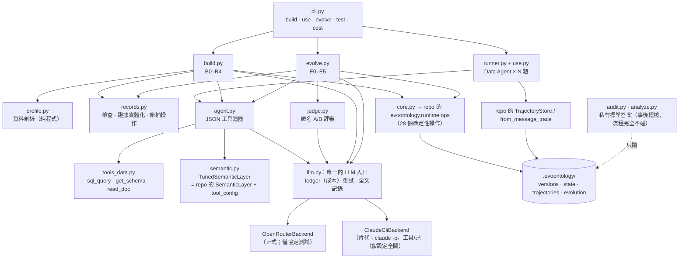

## 3. 本 PoC 的 pipeline 怎麼設計

### 3.1 你的要求，與我怎麼落實

| 你的要求 | 落實方式 |
| --- | --- |
| 整個流程是 deterministic pipeline，由 Python 控制 | `evopipe/` 全是 Python 標準庫；**流程順序、迴圈、停止條件、資料切分、版本命名、Gate、發佈全部由程式決定**。LLM 只回答「這一步需要判斷的問題」，不決定下一步 |
| 需要 LLM 的地方一律走 OpenRouter | 全部 LLM 呼叫集中在 `llm.py` 的**唯一入口** `LLM(role).chat()`；後端可抽換。**OpenRouter 後端已寫好並以本機模擬 server 驗證協定，但沒有金鑰，沒有真的打過 OpenRouter**（見 3.5） |
| 之後不再透過 Claude Code／Codex 執行 | pipeline 不依賴 plugin、MCP、skill 載入機制；repo 的 `evoontology` 核心以 **import** 使用；唯一與 Claude Code 有關的地方是「暫代後端」`claude -p`，而且它被限制成純文字補全（見 3.5） |
| 要確實依 repo 做法，不要自己設計不同的做法 | (a) 狀態、版本、軌跡、觸發器、Gate、演化狀態機**全部呼叫 repo 原本的函式**，不重寫；(b) repo 的 `SKILL.md` 與 `ontology-schema.md` **原文**直接放進 LLM 的 system prompt；(c) 凡是偏離之處都列在 3.4 並說明原因 |
| 想到你未來會自己重寫並加客製化 | 每個階段是一個獨立、可單獨執行、可續跑的函式；所有 prompt 是獨立的 `.md` 檔；所有可調參數在 `config.py`；每個 LLM 輸出都先經程式驗證才會落地；每一步的中間產物都存檔（見 3.7、第 8 章） |
| 你只讀報告、不看 code | 本報告會把每一步的**輸入、LLM 看到什麼、輸出什麼、程式怎麼檢查、磁碟上留下什麼**都寫出來，並附實際執行時的真實內容 |

### 3.2 架構



### 3.3 每個 LLM 呼叫點（一覽）

下表是 pipeline 中**所有**會呼叫 LLM 的地方。其餘一切都是確定性程式。

| 階段 | 角色（模型） | LLM 看到什麼 | LLM 產出什麼 | 程式怎麼檢查／處理產出 |
| --- | --- | --- | --- | --- |
| B2 探勘 | builder（Sonnet） | repo 的 Step 1 原文；建構題；業務文件；程式產生的資料剖析；工具 `sql_query`／`read_doc`／`get_schema` | 證據提案（查詢或文件引文 + 主張） | **程式執行每條查詢並寫入真實結果**；引文必須是文件逐字摘錄；失敗者丟棄 |
| B3 設計 a／b | builder（Sonnet） | repo 的 Step 2 原文 + `ontology-schema.md` 全文；題目；文件；剖析；已驗證證據 | Terms+Mappings，再來 Relations+Constraints+限制+摘要（JSON） | `records.check_records`（見下）；不過就帶著錯誤清單退回重寫，最多 2 次 |
| E1 診斷 | evolver（Sonnet） | repo 的 Step 1 原文與原則；**Pool** 軌跡；語意層目錄；剖析；文件；工具 `probe_semantics`／`sql_query`／`read_doc` | 問題地圖（JSON） | 程式把 `affected_tasks` 過濾成只剩 Pool 內的題目 |
| E2 歸因 | evolver（Sonnet） | repo 的 Step 2 原文；問題地圖；目錄；探測工具 | 競爭的因果假說、維度、主要假說 | 只取格式；`primary` 必須存在 |
| E3 修補 | evolver（Sonnet） | repo 的 Step 3 原文；主要假說；Parent 全部物件；Tool 設定；可用操作清單 | 有型別的修補操作（JSON） | 套用到 Parent 複本 → schema 檢查 → 證據由程式實際執行 → 不得是空修補；有錯就退回，最多 3 次 |
| E4 評審 | judge（Opus） | 評審準則（`evaluation-protocol.md`）；問題；匿名的答案 A／B；各自執行的 SQL 與結果片段 | `{winner, reason, critical_error}` | repo 的 `EvaluationGate.decode` 解匿名；`decide_judge` 聚合 |
| 使用 | agent（Haiku） | Data Agent 說明；manifest；工具 | 工具呼叫序列與最終答案 | `from_message_trace` 正規化成軌跡 |

**`records.check_records` 檢查的規則**（對應 `ontology-schema.md`）：id 全域唯一；Term 型別、名稱、定義、至少一個證據；
Mapping 的 `table`／`column` 必須是**資料庫裡真實存在**的；Relation 型別只能是 5 種、兩端必須是 Term；Constraint 的 `trigger_keywords` 非空、
`severity`／`confidence`／`constraint_type` 在受控詞彙內；所有證據引用必須存在；任何文字欄位出現 SQL 語句即拒絕。

### 3.4 與官方做法不同的地方（偏離清單）

誠實列出，每一項都說明為什麼：

| # | 偏離 | 官方做法 | 為什麼 | 對你的意義 |
| --- | --- | --- | --- | --- |
| D1 | LLM 後端是 `claude -p`，不是 OpenRouter | （官方是 Claude Code／Codex 本身） | 這台機器沒有 OpenRouter 金鑰；你選擇先用 `claude -p` 暫代 | 所有結果是 **Claude Haiku／Sonnet／Opus** 的表現，不是開源模型；換成開源模型後的品質未知。後端已抽換化，換金鑰即可跑 |
| D2 | 工具協定是**文字 JSON**，不用原生 function calling | Claude Code 內建工具呼叫 | 讓任何聊天模型（含開源模型）都能用；也方便你重寫時不綁特定 API | 開源模型可能輸出格式不穩，`agent.py` 內建「格式錯誤重試」 |
| D3 | 證據的 `result` 由程式執行查詢後填入 | Builder agent 自己下 SQL 並手寫 Evidence | 避免幻覺；PoC 1 的 Builder 也回報這是可固定程式的部分 | 這是**改進**，不是缺陷；但證據只能是「單條可重現查詢」的形式 |
| D4 | 修補以「有型別的操作」表達，由程式套用 | Evolver 直接改檔案（甚至程式碼） | pipeline 不能讓 LLM 任意改 Python；操作式修補可驗證、可回復、可 diff | 修補的表達力受操作清單限制（見 4.4） |
| D5 | **Tool Layer 以宣告式旋鈕演化**（`versions/<v>/tool_config.json`） | 允許 agent 改 runtime／prompt／workflow 的程式碼 | 同 D4。三個旋鈕：`resolve.trigger_keyword_constraints`、`resolve.fuzzy_fallback`、`manifest.pinned_constraint_ids`。`SemanticStore.publish` 會複製整個版本資料夾，所以設定隨版本一起走，**不需改 core** | 這是我的擴充，**不是 repo 行為**。你重寫時要決定 Tool Layer 怎麼表示 |
| D6 | **Schema Layer 的演化沒有實作** | 允許 | 改 schema 等於改規格文件與檢查器，不適合自動化 PoC | 歸因階段仍可歸因到 schema，但修補階段只能執行 content／tool |
| D7 | `sql_query` 的執行量上限放寬為約 6 千萬 VM 步 | core 的 `execute_query` 約 100 萬步 | PoC 1 發現 core 的上限會中斷合理的彙總查詢 | 若用 core 的原函式，Builder 會遇到同樣問題 |
| D8 | Judge 除了問題與答案，還看到各方**執行的 SQL 與結果片段** | 協定說工具證據「可選」 | 只給兩個數字的評審什麼都判斷不了；語意工具呼叫**不**給評審看，所以它猜不出誰用了 ontology | 屬協定允許的選項；是否給證據是你的客製點 |
| D9 | 「不可接受的退步」由程式規則判定 | 留給 Evolver agent 判斷 | pipeline 需要確定性規則：Candidate 有任何嚴重錯誤，或 Parent 勝場超過 Candidate 的 1/3 | 這是**我定的政策**，可調 |
| D10 | 驗證集太小時的「重跑確認」實作成**第二次獨立重複** | skill 只說要重跑確認 | 需要具體做法：第一次 Accept 後，用全新的 Parent／Candidate 執行與新的 A/B 隨機化再評一次，**兩次都要 Accept** | 讓 Gate 更保守 |
| D11 | 預算 3 輪 | 預設 8 輪（quick＝2） | 控制成本 | 預算在 run 開始時凍結 |
| D12 | 題目串流的「到達順序」是我安排的 | 真實系統只是依時間 70/30 切 | 讓 Reserve 涵蓋每一類題目，否則某些修補無法被驗證 | 見 4.3，這是實驗設計，不是系統行為 |
| D13 | 任務軌跡由 adapter 風格的程式寫入（`from_message_trace` + `TrajectoryStore.append`），不走 `start/finish_ontology_task` | 兩條路都存在：benchmark adapter 與 host agent 工作流 | pipeline 本來就是 adapter 角色 | 與 `trajectory-format.md` 的說明一致 |

### 3.5 LLM 後端：為什麼這樣設計

```text
                 ┌──────────────── LLM(role).chat(stage, system, messages) ─────────────────┐
 build/evolve/   │  1. 預算檢查（累計成本 ≥ 上限 → 中止）                                      │
 use/judge  ───▶ │  2. backend.complete(model, system, messages)   ← 唯一會連到外部的地方         │ ───▶ 文字
                 │  3. 失敗重試（指數退避）；額度用盡 → LLMUnavailable（階段可續跑）               │
                 │  4. 寫 ledger（tokens、成本、延遲）+ 完整 prompt／回覆存檔                       │
                 └───────────────────────────────────────────────────────────────────────────┘
```

| | OpenRouterBackend（正式） | ClaudeCliBackend（暫代） |
| --- | --- | --- |
| 呼叫方式 | `POST {base}/chat/completions`，`Authorization: Bearer`，`temperature=0`，`usage:{include:true}` | `claude -p --tools "" --system-prompt … --output-format json --no-session-persistence --strict-mcp-config --disable-slash-commands --setting-sources ""`，在乾淨目錄執行 |
| 效果 | 標準 OpenAI 相容聊天 | **純文字補全**：沒有工具、沒有記憶、沒有專案設定；每次呼叫約 600 token 固定開銷 |
| 成本計量 | 回應的 `usage.cost` | JSON 的 `total_cost_usd`（API 牌價） |
| 驗證狀態 | 以本機 `http.server` 模擬 OpenRouter，驗證請求路徑、標頭、body 與成本解析（單元測試）；**未連線過真服務** | 實際使用 |
| 金鑰 | 環境變數 `OPENROUTER_API_KEY` 或 `poc/.env`；不記錄、不輸出 | 不需要 |
| 取樣 | `temperature=0` | 無法設定溫度 → 結果有隨機性 |

換到 OpenRouter 時：設好金鑰、`EVOPIPE_BACKEND=openrouter`、在 `config.py` 的 `OPENROUTER_ROLE_MODELS` 指定每個角色的模型即可。
我預設填的模型 id 是占位（未用你的金鑰驗證過是否可用、是否支援你需要的輸出格式）。

### 3.6 Agent 工具迴圈（`agent.py`）

每一輪模型必須回覆**一個 JSON 物件** `{"thought", "tool", "args"}`；Python 執行工具、把結果放進下一則訊息；模型呼叫「最終工具」（如 `submit_answer`）或達到步數上限即結束。

- `thought` 只用來讓模型先想一句，**不存進軌跡**（`trajectory-format.md`：不存思考鏈）。
- 格式錯誤會回饋給模型重試，連續 3 次失敗才放棄；未知工具、工具例外都以 `{"error": …}` 回給模型，不會讓流程崩潰。
- 一次只能呼叫一個工具，所以不會再出現 PoC 1 中「把送出答案和最後查詢並行」的問題。
- 工具結果在給模型看時截斷到 3,500 字元；寫入軌跡時另有 2 KB／20 行的上限。

### 3.7 程式碼模組地圖（`poc/v3/evopipe/`）

| 檔案 | 責任 | 用到 LLM？ | 對應 repo 的哪裡 |
| --- | --- | :-: | --- |
| `config.py` | 路徑、角色→模型、預算、所有旋鈕 | — | — |
| `llm.py` | **唯一的 LLM 入口**、兩個後端、成本帳本、JSON 解析 | ✔ | — |
| `agent.py` | JSON 工具迴圈 | ✔ | （plugin 裡由 Claude Code 本身扮演） |
| `tools_data.py` | `sql_query`、`get_schema`、`read_doc` | — | `ProjectWorkflow.execute_query` |
| `semantic.py` | `TunedSemanticLayer`（repo 的 `SemanticLayer` + `tool_config`） | — | `runtime/runtime.py` |
| `profile.py` | B1 資料剖析 | — | PoC 1 中 Builder 手寫的 SQL |
| `records.py` | 物件檢查、證據實體化、修補操作、版本 diff | — | `validate.py`（本檔規則更多） |
| `build.py` | B0–B4 | ✔ | build-ontology skill |
| `use.py`、`runner.py` | Data Agent、軌跡正規化、並行與快取 | ✔ | benchmark adapter 端 |
| `evolve.py` | E0–E5 | ✔ | evolve-ontology skill + `EvolutionSession` |
| `judge.py` | 匿名評審、退步規則 | ✔ | `docs/evaluation-protocol.md` |
| `audit.py`、`analyze.py` | 用私有標準答案事後稽核 | — | （repo 沒有，因正式環境無 GT） |
| `core.py` | 呼叫 repo 的 28 個確定性操作 | — | `runtime/ops.py` |
| `cli.py` | 命令列入口 | — | — |
| `prompts/*.md` | 所有 prompt（可獨立編輯） | — | skill 原文由程式在執行時載入 |
